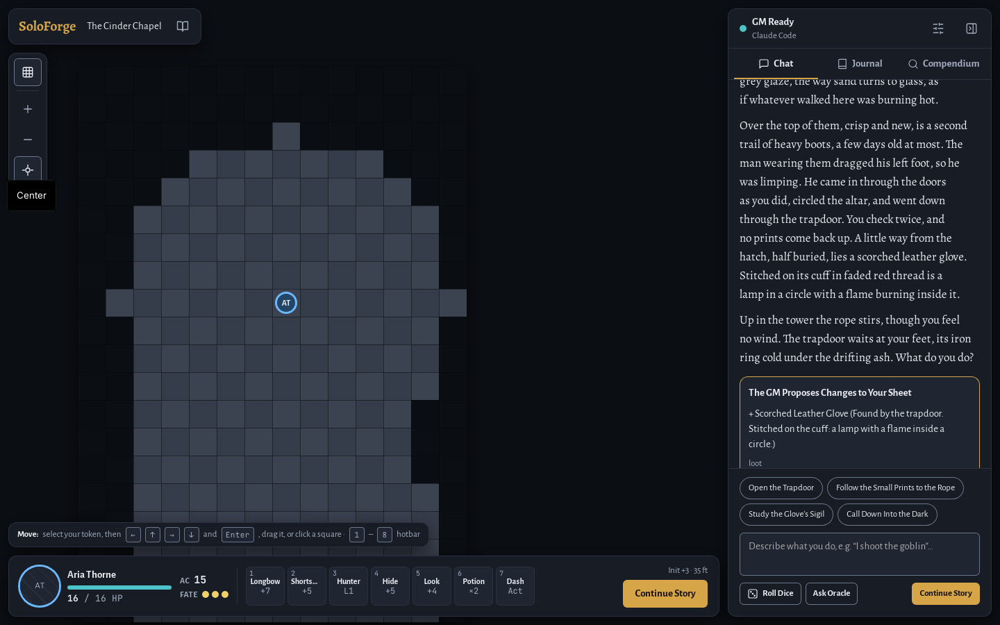
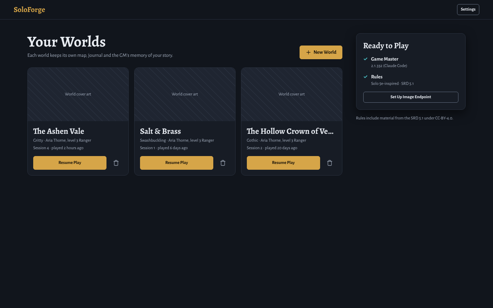
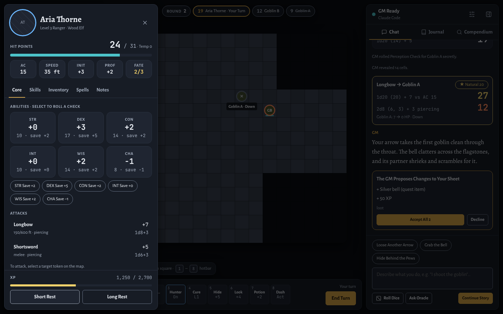
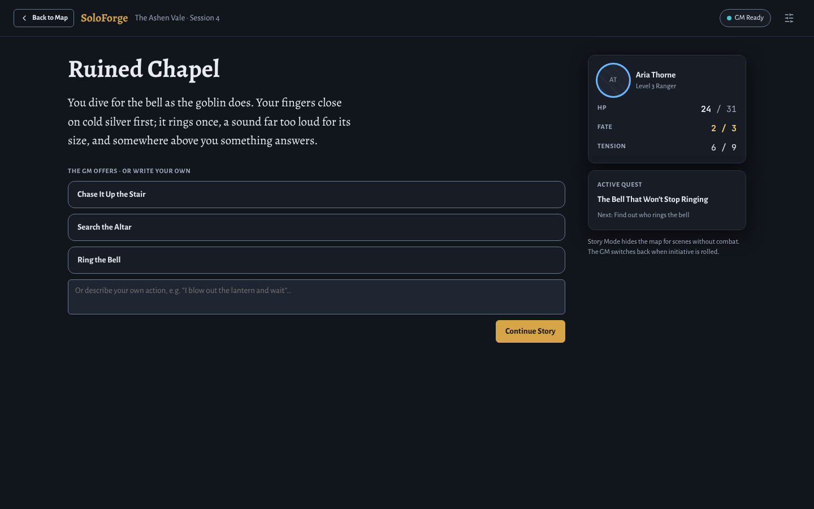
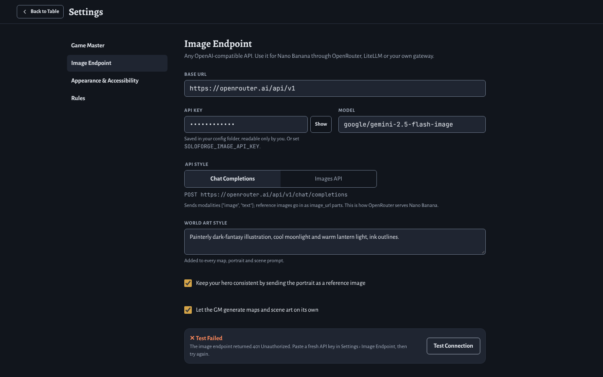

# SoloForge

A desktop virtual tabletop for **one player and an AI Game Master**. Claude Code runs the story and the rules through real table tools: maps, tokens, dice, HP, combat, journal and an oracle. Any OpenAI-compatible image endpoint (for example Nano Banana through OpenRouter) paints the battle maps, portraits and scene art.

The rules are **Solo 5e-inspired**: d20 checks, advantage, AC, HP and conditions from the SRD 5.1, plus solo rules (Fate points, minions, Tension and an oracle) tuned for a single hero.



| | |
|---|---|
|  |  |
|  |  |

## How it works

```
┌──────────── SoloForge (Tauri 2 window) ────────────┐
│  SolidJS UI ── invoke() ──▶ Rust core (World, rules, dice)
│        ◀── events: world://changed, gm://delta ───┘
│  MCP table server (127.0.0.1, per-launch token) · image client
└─────▲────────────────────────────────────────▲────┘
      │ mcp__vtt__* tools                      │ HTTPS
  `claude -p --output-format stream-json`   OpenAI-compatible images
```

- **The GM is your installed Claude Code.** Each GM turn runs `claude -p` in streaming mode with `--resume`, so the campaign keeps its memory.
  - Built-in tools are turned off (`--tools ""`), so the GM can only use the table's `mcp__vtt__*` tools: dice, tokens, scenes, fog, combat, journal, oracle and images.
  - The SoloForge window itself never calls Claude or the image API.
- **Every roll comes from the app's RNG.** The GM can't make up results, and the UI shows each roll card as it happens.
- **The GM asks before changing your sheet.** Loot and XP arrive as proposals you accept or decline.

## Download

Prebuilt installers for Windows, macOS (Apple silicon and Intel) and Linux are on the [Releases page](https://github.com/Aegis-plus/SoloForge/releases). To publish a new release, bump the version in `package.json`, `Cargo.toml` and `src-tauri/tauri.conf.json`, then push a tag such as `v0.1.1`. The **Release** workflow builds every platform and attaches the installers.

## Requirements

- **Claude Code**, installed and signed in. Run `claude` once in a terminal. No Anthropic API key is needed.
- **Rust** (stable) and **Node.js 20+**.
- **Linux:** `libwebkit2gtk-4.1-dev libgtk-3-dev libayatana-appindicator3-dev librsvg2-dev`.
- **macOS:** Xcode command line tools.
- **Windows:** WebView2, which is already part of Windows 11.
- **Optional:** an image endpoint and API key. Set them in Settings › Image Endpoint, or set `SOLOFORGE_IMAGE_API_KEY` in your environment.

## Run it

```bash
npm install
```

```bash
npm run tauri dev
```

Build installers (`.deb`, `.AppImage`, `.dmg` or `.msi`, depending on your OS):

```bash
npm run tauri build
```

## Building the Rust side

The Rust side builds with **cargo**:

```bash
npm run check
```

```bash
npm test
```

These run `cargo check --workspace --all-targets` and `cargo test --workspace` (plus `tsc` and Vitest).

**blaze is opt-in for now.** [blaze](https://github.com/indexable-inc/blaze) is pinned in `Cargo.toml` (`[workspace.metadata.blaze]`), but its current release (0.20261122.0) ships without the toolchain it needs. To try it, add `--blaze` (`node scripts/rust.mjs test --blaze`) or set `SOLOFORGE_USE_BLAZE=1`. If blaze can't build on your machine, the script falls back to cargo.

## Image endpoint

| API style | Request | Where the image is read from |
|---|---|---|
| Chat Completions (OpenRouter's Nano Banana) | `POST {base}/chat/completions` with `modalities: ["image","text"]` | `choices[0].message.images[].image_url.url` or image content parts |
| Images API | `POST {base}/images/generations` (`/images/edits` with references) | `data[0].b64_json` or `data[0].url` |

For example, base URL `https://openrouter.ai/api/v1` with model `google/gemini-2.5-flash-image`. The **Test Connection** button generates one small image. Errors say how to fix them (bad key, wrong model, out of credit).

## Development

| Command | What it does |
|---|---|
| `npm run dev` | UI in a browser with an in-memory mock backend (no Tauri, no Claude) |
| `npm run test:web` | Vitest unit tests |
| `npm run e2e` | Playwright smoke test against the mock: keyboard token moves, drawer, streaming GM, delete with undo, settings errors, wizard validation |
| `cargo run -p soloforge-core --bin mcp-dev -- --turn "I look around"` | Headless table plus one real Claude Code GM turn, printed to the terminal |
| `cargo test --workspace` | Rust tests: rules, dice statistics, oracle, combat, store, the MCP server over HTTP, the stream-json parser, the image client against a mock server |

**Where things are saved:**
- Worlds: `~/.local/share/soloforge/worlds/<id>/`, holding `world.json` and `images/` (or your OS's data folder).
- Settings: `~/.config/soloforge/config.json`, written with permissions 0600.
- Deleted worlds go to `trash/` so the launcher can offer Undo.

## Design

The UI follows the SoloForge design system: the Midnight and Vellum themes, Alegreya, Alegreya Sans and JetBrains Mono. It was reviewed with Vercel's Web Interface Guidelines; the skill is in `.claude/skills/web-design-guidelines`. Accessibility features:
- Keyboard alternatives for every drag: arrow keys move your token, and keys 1–8 fire the hotbar.
- Visible focus rings, plus Reduce Motion and High Contrast settings.
- Live regions for streamed narration.

## Layout

```
crates/core/   game core: world, rules, MCP server, GM runner, image client (no Tauri)
src-tauri/     Tauri 2 shell: commands, events, capabilities
src/           SolidJS app (screens/, components/, lib/, styles/)
assets/        GM prompt, rules text, SRD-derived compendium
```

## License

MIT or Apache-2.0. Includes SRD 5.1 material under CC-BY-4.0; see [NOTICE](NOTICE).
